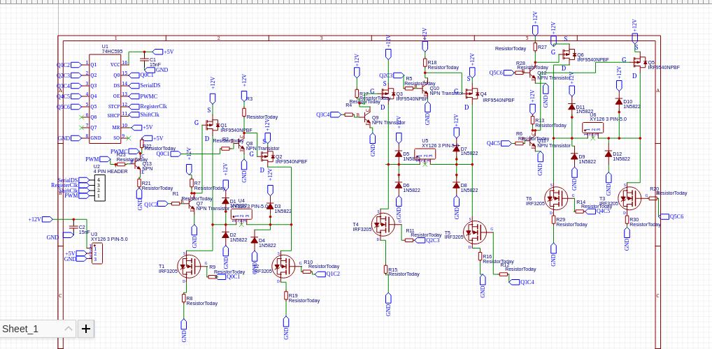
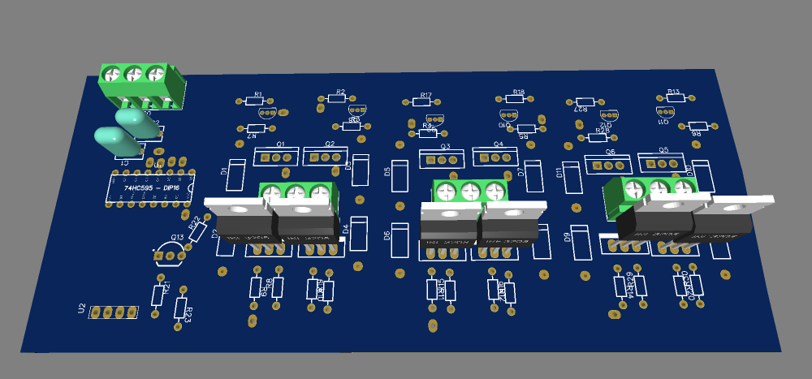
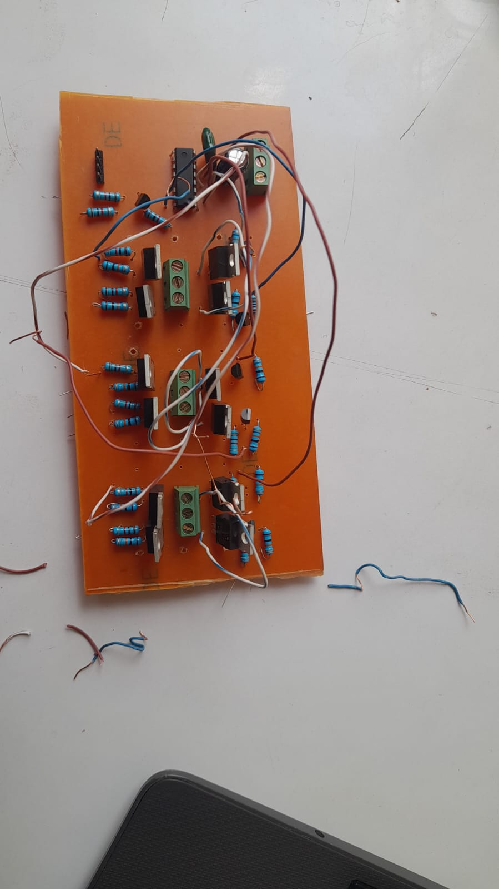

# ThreeZoneDriver

ThreeZoneDriver is a lightweight Arduino library for controlling three independent motor zones using a 74HC595 shift register and a single PWM speed signal.

It is designed for systems where each motor zone needs independent direction control while sharing a common speed setting. The library includes a direction-change deadtime to reduce shoot-through risk when switching between forward and reverse.

## Features

- 3 independent motor zones
- Direction control for each zone: FORWARD, REVERSE, STOP
- Global PWM speed control from 0 to 255
- Built-in deadtime during direct reversals
- Simple Arduino-friendly API
- Compatible with a 74HC595-based driver design

## Hardware model

This library assumes a driver arrangement where each motor zone uses two bits in the shift register:

- Zone 1: bits 0-1
- Zone 2: bits 2-3
- Zone 3: bits 4-5

A single PWM-capable pin is used for the overall motor speed.

## API

```cpp
#include <ThreeZoneDriver.h>

ThreeZoneDriver motors(2, 3, 4, 5, 50);  // ds, shclk, rclk, pwm, deadtimeUs

void setup() {
  motors.begin();
  motors.setSpeed(200);
}

void loop() {
  motors.setZone(1, FORWARD);
  motors.setZone(2, FORWARD);
  motors.setZone(3, REVERSE);
  delay(2000);

  motors.setZone(1, STOP);
  motors.setZone(2, STOP);
  motors.setZone(3, STOP);
  delay(1000);

  motors.stopAll();
  delay(5000);
}
```

## Methods

- `ThreeZoneDriver(uint8_t dsPin, uint8_t shclkPin, uint8_t rclkPin, uint8_t pwmPin, uint16_t deadtimeUs = 50)`
  - Construct a driver instance.
- `void begin()`
  - Configure pins and initialize the driver to a stopped state.
- `void setZone(uint8_t zone, Direction dir)`
  - Set a zone direction. Valid zone values are 1 through 3.
- `void setSpeed(uint8_t speed)`
  - Set the PWM speed output from 0 to 255.
- `void stopAll()`
  - Stop all zones and set PWM to zero.

## Direction enum

```cpp
enum Direction {
  STOP = 0,
  FORWARD = 1,
  REVERSE = 2
};
```

## Example sketch

The repository includes a basic example in `examples/BasicControl/BasicControl.ino` that demonstrates:

- driving all zones forward
- driving all zones in reverse
- a mixed-direction maneuver
- stopping all zones

## License

This project is open source and released under the MIT License. See the `LICENSE` file for details.

## Project status

This library is intended for Arduino-compatible embedded projects and driver boards that use a 74HC595-based digital control scheme for multi-zone DC motor control.

## Schematic & Architecture


## PCB 3D Render


## Product Image

